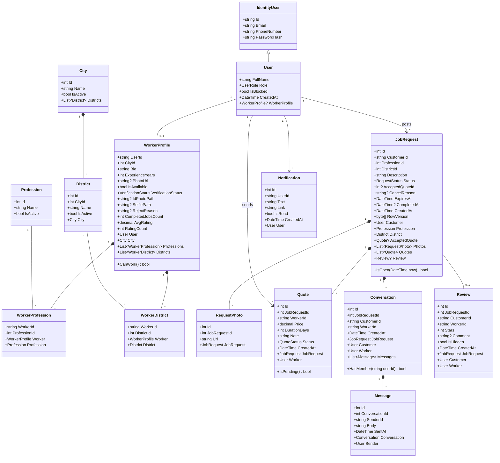
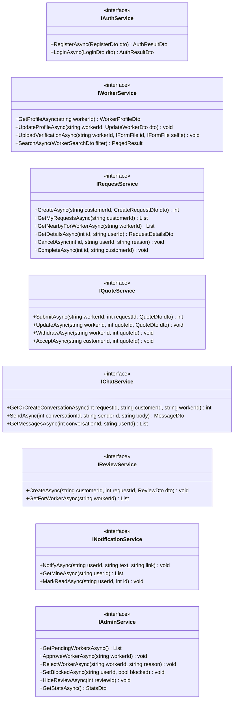
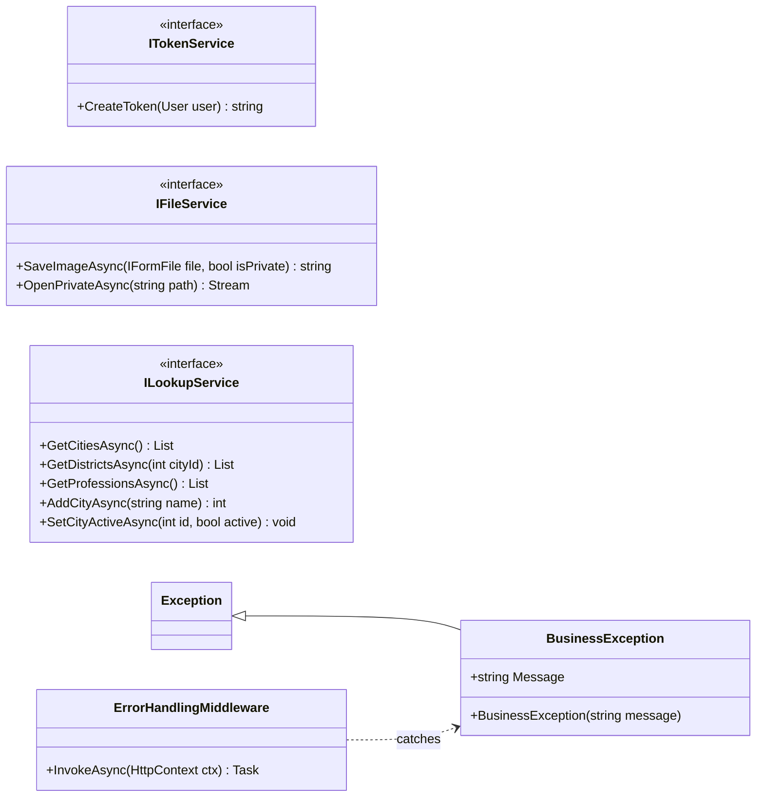

# Sanai3y — Class Design

Oct 9, 2026&#32;

The backend uses three simple layers: **Controllers → Services → Data (EF Core)**. Entities are plain classes with a couple of helper methods; the business rules live in one service per module, so anyone can open a service and follow the whole feature top to bottom. Table and column names match the ERD file.

## 1. Solution structure

References go one way only: **Api → Services → Data**. Controllers never touch `AppDbContext` directly.

```text
Sanai3y.sln
├── Sanai3y.Data/              entities, enums, AppDbContext, EF configurations, migrations, seed data
│   ├── Entities/              User, WorkerProfile, City, District, Profession, JobRequest, Quote, ...
│   ├── Enums/                 UserRole, VerificationStatus, RequestStatus, QuoteStatus
│   └── AppDbContext.cs
├── Sanai3y.Services/          business logic
│   ├── Auth/                  AuthService, TokenService
│   ├── Workers/               WorkerService
│   ├── Requests/              RequestService
│   ├── Quotes/                QuoteService
│   ├── Chat/                  ChatService
│   ├── Reviews/               ReviewService
│   ├── Notifications/         NotificationService
│   ├── Admin/                 AdminService, LookupService
│   ├── Files/                 FileService
│   └── Dtos/                  request and response DTOs per module
├── Sanai3y.Api/               controllers, ChatHub, ExpireRequestsWorker, Program.cs
├── Sanai3y.Tests/             xUnit tests for the services against a SQL Server test database
└── client/                    React + TypeScript
```

## 2. Entity classes

One class per table, with navigation properties for EF Core. Only three small helper methods sit on entities; everything else is in services.



- `WorkerProfile.CanWork()` → `VerificationStatus == Approved && !User.IsBlocked`.
- `JobRequest.IsOpen(now)` → `Status == Open && now < ExpiresAt`.
- `Quote.IsPending()` → `Status == Pending`.
- Nullable columns (`AcceptedQuoteId`, `CompletedAt`, `RejectReason`, …) are nullable in C# too (`int?`, `DateTime?`, `string?`).

## 3. Services

Each service has an interface (so it can be registered in DI and faked in tests) and one implementation that uses `AppDbContext`. A service method receives the current user's id from the controller and returns a DTO; when a rule is broken it throws `BusinessException` with a clear message, which one middleware turns into HTTP 400.



**Helper services and error handling**



- `ErrorHandlingMiddleware` catches `BusinessException` → 400 with `{ "message": "..." }`; any other exception → 500 with a generic message (details only in the log).
- `IFileService.SaveImageAsync` accepts only `.jpg`, `.jpeg`, `.png` up to 5 MB, renames the file to a GUID, and saves private files (ID photos) outside `wwwroot` so they can only be read through the admin endpoint.

**The JWT must carry the role.** `[Authorize(Roles = "Customer")]` reads `ClaimTypes.Role` from the token, so `TokenService` adds it:

```csharp
var claims = new List<Claim>
{
    new(ClaimTypes.NameIdentifier, user.Id),
    new(ClaimTypes.Name, user.FullName),
    new(ClaimTypes.Role, user.Role.ToString())   // "Customer", "Worker" or "Admin"
};
```

`AuthService.LoginAsync` also refuses to issue a token when `user.IsBlocked` is true, and a small check in the middleware rejects requests from users blocked after their token was issued.

**Smaller helpers:** `ILookupService` (cities, districts, professions — read for everyone, write for admin), `ITokenService` (creates the JWT), `IFileService` (saves an uploaded image and returns its path).

**Who calls whom:** `QuoteService.AcceptAsync`, `RequestService.CreateAsync`, `AdminService.ApproveWorkerAsync` and `ChatService.SendAsync` call `INotificationService`, which saves the notification and pushes it through SignalR. Rating recalculation is a private method inside `ReviewService` and `AdminService.HideReviewAsync`.

**Background work:** `ExpireRequestsWorker : BackgroundService` runs every hour and sets `Status = Expired` for Open requests whose `ExpiresAt` has passed.

## 4. Controllers, hub and DTOs

A controller action does three things: read the user id from the token, call one service method, return the result. No `if` about business rules in controllers.

| Controller | Routes (`/api/...`) | Who |
| --- | --- | --- |
| AuthController | `POST auth/register`, `POST auth/login` | Anyone |
| LookupsController | `GET cities`, `GET cities/{id}/districts`, `GET professions` | Anyone |
| WorkersController | `GET workers` (search), `GET workers/{id}`, `PUT workers/me`, `POST workers/me/verification` | Anyone / Worker |
| RequestsController | `POST requests`, `GET requests/mine`, `GET requests/nearby`, `GET requests/{id}`, `POST requests/{id}/cancel`, `POST requests/{id}/complete` | Customer / Worker |
| QuotesController | `POST requests/{id}/quotes`, `PUT quotes/{id}`, `POST quotes/{id}/withdraw`, `POST quotes/{id}/accept` | Worker / Customer |
| ChatController | `POST requests/{id}/chat`, `GET chats/{id}/messages` | Customer / Worker |
| ReviewsController | `POST requests/{id}/review`, `GET workers/{id}/reviews` | Customer / Anyone |
| NotificationsController | `GET notifications`, `POST notifications/{id}/read` | Logged in |
| AdminController | `GET admin/workers/pending`, `GET admin/workers/{id}/documents/{type}`, `POST admin/workers/{id}/approve`, `POST admin/workers/{id}/reject`, `GET admin/users`, `POST admin/users/{id}/block`, `POST admin/users/{id}/unblock`, `GET admin/reviews`, `POST admin/reviews/{id}/hide`, `GET admin/stats`, lookups CRUD | Admin |
| **ChatHub** (SignalR) | client → `SendMessage(conversationId, text)`; server → `ReceiveMessage`, `ReceiveNotification` | Logged in |

**DTO naming:** `CreateRequestDto` (input), `RequestDetailsDto` (output), `RequestListItemDto` (list row). Validate inputs with data annotations (`[Required]`, `[Range(1,5)]`, `[MaxLength(1000)]`). Never return an entity from a controller.

**Phone reveal.** `RequestDetailsDto` has `CustomerPhone` (string?) and `AcceptedWorkerPhone` (string?). `RequestService.GetDetailsAsync` fills them only when the request is Agreed or Completed **and** the viewer is the customer or the accepted worker; for everyone else they stay `null`. The rule lives in the service, so the phone never reaches the browser of a worker who was not chosen.

## 5. Worked example: accepting a quote

Every feature follows this shape: controller → service (check rules, change data, save) → notification. This one also shows the one tricky part of the project: making sure only one quote is accepted.

**Controller**

```csharp
[Authorize(Roles = "Customer")]
[HttpPost("quotes/{id}/accept")]
public async Task<IActionResult> Accept(int id)
{
    var userId = User.FindFirstValue(ClaimTypes.NameIdentifier)!;
    await _quoteService.AcceptAsync(userId, id);
    return NoContent();
}
```

**Service**

```csharp
public async Task AcceptAsync(string customerId, int quoteId)
{
    var quote = await _db.Quotes
        .Include(q => q.JobRequest).ThenInclude(r => r.Quotes)
        .FirstOrDefaultAsync(q => q.Id == quoteId)
        ?? throw new BusinessException("Quote not found.");

    var request = quote.JobRequest;
    if (request.CustomerId != customerId)
        throw new BusinessException("This is not your request.");
    if (!request.IsOpen(DateTime.UtcNow))
        throw new BusinessException("This request is no longer open.");
    if (!quote.IsPending())
        throw new BusinessException("This quote can no longer be accepted.");

    quote.Status = QuoteStatus.Accepted;
    foreach (var other in request.Quotes.Where(q => q.Id != quoteId && q.IsPending()))
        other.Status = QuoteStatus.Rejected;

    request.Status = RequestStatus.Agreed;
    request.AcceptedQuoteId = quote.Id;

    try
    {
        await _db.SaveChangesAsync();   // one transaction; RowVersion is checked here
    }
    catch (DbUpdateConcurrencyException)
    {
        throw new BusinessException("This request was already updated. Please refresh.");
    }

    await _notifications.NotifyAsync(quote.WorkerId, "Your quote was accepted", $"/requests/{request.Id}");
    foreach (var other in request.Quotes.Where(q => q.Status == QuoteStatus.Rejected))
        await _notifications.NotifyAsync(other.WorkerId, "The customer chose another quote", $"/requests/{request.Id}");
}
```

**EF configuration for RowVersion** (in `AppDbContext.OnModelCreating`):

```csharp
modelBuilder.Entity<JobRequest>().Property(r => r.RowVersion).IsRowVersion();
```

**Why it works:** if two browser tabs accept different quotes at the same moment, both read the same `RowVersion`. The first save changes it; the second save finds a different value, EF Core throws `DbUpdateConcurrencyException`, and the second customer sees "Please refresh".

**Test idea:** create a request with two quotes, accept one, then check the request is Agreed, the other quote is Rejected, and accepting again throws `BusinessException`.

**Which database for tests:** run the tests against a real SQL Server test database (LocalDB on Windows, or the SQL Server Docker container), created fresh by a test fixture. Don't use the EF Core InMemory provider: it ignores `RowVersion`, unique indexes and foreign keys, so the double-accept test would pass even if the code were wrong.

## 6. Coding rules for the team

- Controllers only call services; services only use `AppDbContext`.
- Every service method that changes data first checks: does this user own it, and is the status right?
- Throw `BusinessException("clear message")` for broken rules; one middleware returns it as 400 with `{ "message": "..." }`.
- Use `DateTime.UtcNow`, never `DateTime.Now`.
- Return DTOs, never entities.
- One file per class; folder per module, same names in backend and frontend.
- Every service method that changes a status gets one test for the happy path and one for a rule being broken.
