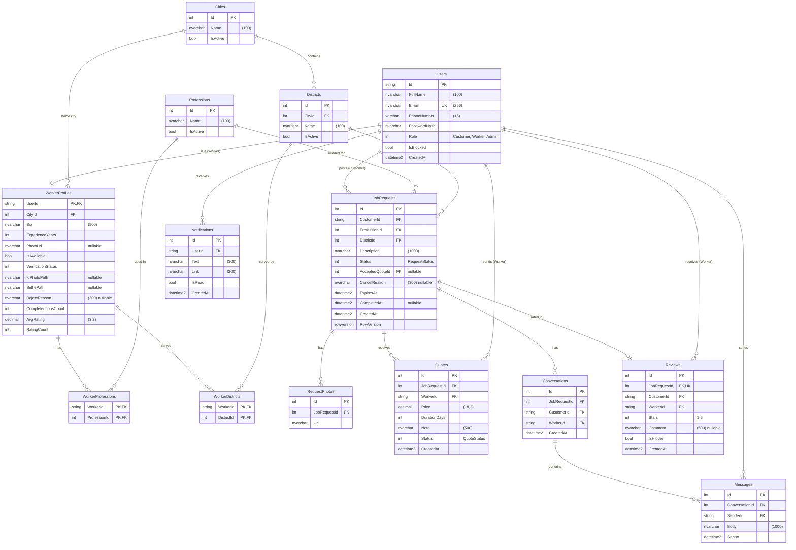

# Sanai3y — ERD

Oct 9, 2026 ·&#32;

The simplified MVP needs **14 tables** in SQL Server, built with EF Core Code First, all in one diagram. Table and column names are the ones to use in C#.

## 1. Conventions

| Topic | Rule |
| --- | --- |
| Primary keys | `int` identity everywhere (easy to read in Swagger and SQL); `Users.Id` is a `string` because that is the ASP.NET Core Identity default |
| Join tables | `WorkerProfessions` and `WorkerDistricts` use the two FKs together as the PK |
| Dates | `CreatedAt` on every table, `datetime2`, saved in UTC |
| Money | `decimal(18,2)`, EGP |
| Text | `nvarchar` so Arabic works |
| Enums | Saved as `int` (Section 6) |
| Concurrency | Only `JobRequests` has a `RowVersion` column, to stop two quotes being accepted |
| Deleting | No soft delete. Cities, districts and professions have `IsActive` instead of being deleted |

In the diagram **PK** = primary key, **FK** = foreign key, **UK** = unique.

## 2. ERD

Verification is just four columns on `WorkerProfiles` (status, two photo paths, reject reason) instead of separate tables. A customer needs no profile table: name and phone live on `Users`.

## 3. What each table is for

| Table | Purpose |
| --- | --- |
| Users | Every account (Identity user + `Role` + `IsBlocked`) |
| WorkerProfiles | Extra data for workers: profile, verification, rating stats |
| Cities, Districts, Professions | Lookup lists managed by the admin |
| WorkerProfessions | Which professions a worker does |
| WorkerDistricts | Which districts a worker serves |
| JobRequests | A customer's problem and its status |
| RequestPhotos | Up to 3 photos per request |
| Quotes | A worker's price offer for a request |
| Conversations | One chat between a customer and a worker about a request |
| Messages | Chat messages |
| Reviews | The customer's rating of the worker after completion |
| Notifications | Bell-icon notifications |

## 4. Relationships and delete behaviour

Set `OnDelete(DeleteBehavior.Restrict)` on every relationship that points at `Users`; SQL Server rejects more than one cascade path to the same table (for example Users → Conversations twice). Cascade only where the child means nothing alone.

| Parent → Child | Type | On delete |
| --- | --- | --- |
| Users → WorkerProfiles | 1 : 0..1 | Cascade |
| Cities → Districts | 1 : N | Restrict |
| WorkerProfiles → WorkerProfessions, WorkerDistricts | 1 : N | Cascade |
| Professions / Districts → WorkerProfessions / WorkerDistricts | 1 : N | Restrict |
| Users → JobRequests (customer) | 1 : N | Restrict |
| JobRequests → RequestPhotos | 1 : N | Cascade |
| JobRequests → Quotes | 1 : N | Cascade |
| Users → Quotes (worker) | 1 : N | Restrict |
| JobRequests → AcceptedQuote | 0..1 | No action |
| JobRequests → Conversations | 1 : N | Cascade |
| Conversations → Messages | 1 : N | Cascade |
| JobRequests → Reviews | 1 : 0..1 | Restrict |
| Users → Notifications | 1 : N | Cascade |

**Note on `AcceptedQuoteId`:** `JobRequests` points at `Quotes` and `Quotes` points back at `JobRequests`. Keep `AcceptedQuoteId` nullable and configure it as `HasOne<Quote>().WithMany().HasForeignKey(r => r.AcceptedQuoteId).OnDelete(DeleteBehavior.NoAction)`.

## 5. Unique constraints and indexes

| Table | Columns | Type | Why |
| --- | --- | --- | --- |
| Users | Email | Unique | One account per email |
| Quotes | (JobRequestId, WorkerId) | Unique | One quote per worker per request |
| Conversations | (JobRequestId, CustomerId, WorkerId) | Unique | One chat per pair per request |
| Reviews | JobRequestId | Unique | One review per request |
| JobRequests | (Status, ProfessionId, DistrictId) | Index | "Requests near me" for workers |
| JobRequests | CustomerId | Index | "My requests" |
| WorkerDistricts | DistrictId | Index | Worker search |
| Messages | (ConversationId, SentAt) | Index | Loading a chat |
| Notifications | (UserId, IsRead) | Index | Bell count |

**Check constraints:** `Reviews.Stars BETWEEN 1 AND 5`, `Quotes.Price > 0`, `Quotes.DurationDays > 0`.

## 6. Enums

| Enum | Values |
| --- | --- |
| UserRole | 1 Customer, 2 Worker, 3 Admin |
| VerificationStatus | 0 NotSubmitted, 1 Pending, 2 Approved, 3 Rejected |
| RequestStatus | 1 Open, 2 Agreed, 3 Completed, 4 Cancelled, 5 Expired |
| QuoteStatus | 1 Pending, 2 Accepted, 3 Rejected, 4 Withdrawn |
